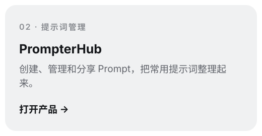
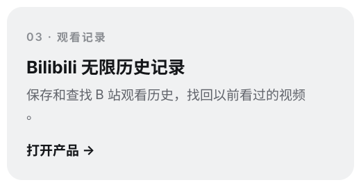
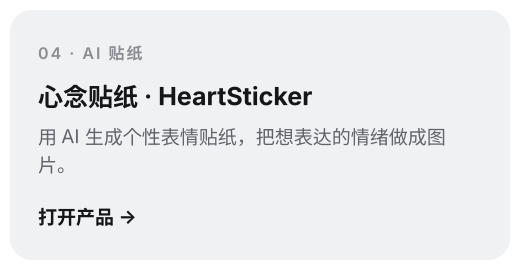
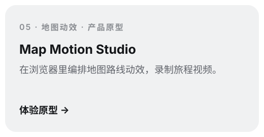
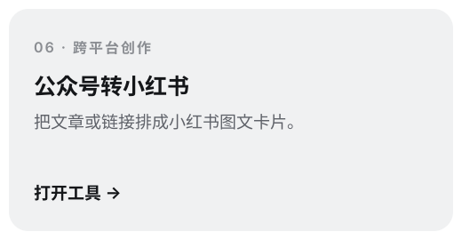
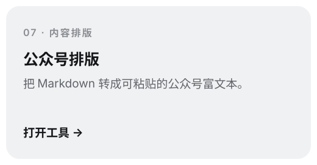
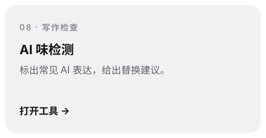
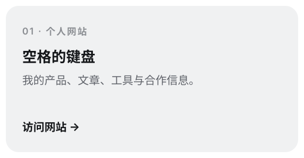
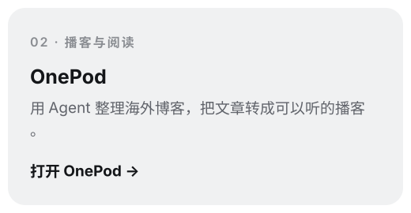
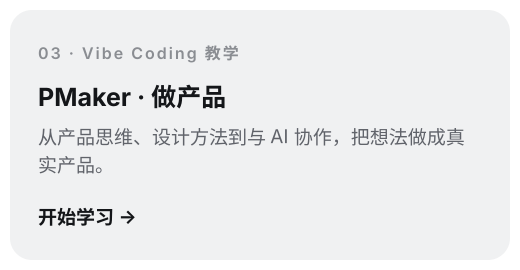

  

我是空格，产品经理、AI 开发者，我的自媒体 IP 是「空格的键盘」。我把工作和创作里用得上的方法，做成 Skill、插件和网页产品，也把实践写成教程。

## 01 · Skill

### 热门 Skill

| 项目 | 能帮你做什么 | Star |
| --- | --- | --- |
| [Creator Buddy](https://github.com/SpaceZephyr/creator-buddy) | 公众号、小红书、视频创作：从搜热点、拆爆款，到正文、配图、剪辑和封面 |  |
| [PM Skills](https://github.com/SpaceZephyr/pm-skills) | 产品经理工具箱与专家顾问团：PRD、需求评审、优先级、实验、埋点和复盘 |  |
| [Design Buddy](https://github.com/SpaceZephyr/design-buddy) | 把内容做成品牌设计系统、图片、图解、信息图、Logo、PPT 和社交图文 |  |
| [career.skill](https://github.com/SpaceZephyr/career.skill) | 输入职业，生成专家视角、书籍方法论与总控组成的私人 AI 顾问团 |  |
| [brand-design-md](https://github.com/SpaceZephyr/brand-design-md) | 读取 62 个品牌的设计规范，按颜色、字体和间距生成 UI；独立版，也已收录于 Design Buddy |  |
| [Read Buddy](https://github.com/SpaceZephyr/read-buddy) | 读网页、RSS、视频字幕、飞书文档与播客，把资料整理成可复用的知识素材 |  |
| [myskill](https://github.com/SpaceZephyr/myskill) | 个人积累的 Skill 合集，包含自建与收集的能力；适合按目录找灵感 |  |

### 更多 Skill

| Skill | 用来做什么 |
| --- | --- |
| [Build Your Harness](https://github.com/SpaceZephyr/build-your-harness) | 给 AI 项目搭上下文、工具和记忆，再做一次体检 |
| [多风格 PPT](https://github.com/SpaceZephyr/space-multi-design-ppt) | 按品牌设计风格制作演示文稿 |
| [Personal Site Builder](https://github.com/SpaceZephyr/personal-site-builder) | 把简历、社交资料和作品集做成个人网站 |
| [Map Motion](https://github.com/SpaceZephyr/map-motion) | 基于真实路线与地图数据，制作地图动效视频 |
| [Travel Vlog](https://github.com/SpaceZephyr/travel-vlog) | 把旅行照片做成沿路线展开的地图 Vlog |
| [Travel Roadbook](https://github.com/SpaceZephyr/travel-roadbook-skill) | 规划旅行与自驾路线，生成手机上能看的路书 |
| [job.skill](https://github.com/SpaceZephyr/job.skill) | 从《豆包工作职业手册》提炼岗位场景，覆盖运营、市场、销售、HR、财务、研发和设计 |

安装方式与所需配置见各仓库 README。

## 02 · 插件

| 插件 | 平台 | 用来做什么 |
| --- | --- | --- |
| [Cowrite](https://github.com/SpaceZephyr/cowrite) | Codex / Claude Code | 本地 AI 写作画布，和 Agent 一起改文章、做配图、整理文档 |
| [SkillDeck](https://github.com/SpaceZephyr/skilldeck) | Codex / 独立 Web 版 | 把本地 Skill 变成可搜索的卡片墙，按任务挑选、组合和调用 |
| [飞书排版](https://github.com/SpaceZephyr/feishu-convert) | Chrome | 把飞书文档转成小红书图文卡片或公众号富文本 |

## 03 · 网页产品

有独立开发的，也有和朋友一起做的。

  
  

  
  

  
  

  
  

[查看全部工具 →](https://konge.space/tools/) · [Map Motion Studio 源码](https://github.com/SpaceZephyr/map-motion-studio)

## 04 · 网站

  
  

  
  

## 05 · 社媒

  
  
  

  
  
  

产品反馈欢迎到对应仓库提 Issue。合作联系：[wzfh520@gmail.com](mailto:wzfh520@gmail.com)。
